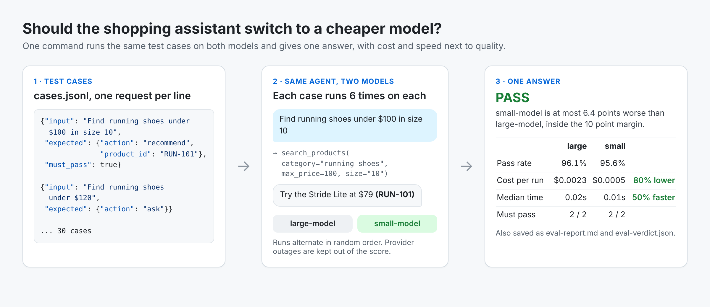

# AI Agent Evaluation

[](https://github.com/dhruv1999/AI-Agent-Evaluation/actions/workflows/ci.yml)
[](LICENSE)

[](https://pypi.org/project/ai-agent-evaluation/)

**Should your agent switch models? Find out in an afternoon, not a day.**

Run your agent's test cases on the model you use today and the one you are considering. You get one honest answer, **pass**, **regressed** or **not enough data**, with the cost and speed of each model next to it.



## The problem

A newer or cheaper model comes out, or the old one is retired. Before switching, someone has to rerun every test case on the new model and compare the results by hand.

- **It is slow.** A day of reruns and side by side reading for one decision.
- **One run per case proves little.** Agents answer differently every time. In our simulations, comparing one run per case flagged a regression in 48% to 100% of swaps where nothing had changed.
- **Nobody can say what "about the same" means.** Does it include the payments flow? Is the new model 3 points worse or 15?
- **Cost and speed sit somewhere else.** They are usually the reason to switch, but they are not on the same page as quality.

## Who it is for

- **Developers on small teams** whose agent already has test cases, or a script that runs it a few times.
- **Agents whose results code can check:** the right product was recommended, the right tool was called, the output parses. Answers that need a person or a model to grade them are not supported yet.

## What it does

- **Runs both models on your cases**, 6 runs per case per model, shuffled so a slow minute at the provider hits both alike.
- **Gives one answer for the suite:** pass if the new model is at most your margin worse (10 points by default), regressed if it is clearly worse, not enough data if the runs cannot tell. *(non-inferiority test)*
- **Stops early when the answer is already clear,** after half the runs. *(two looks)*
- **Never lets a critical case hide in the average.** Mark it must pass and it can fail the comparison on its own.
- **Keeps provider outages out of the score.** Rate limits and server errors are counted separately, not blamed on the model.
- **Shows what each correct answer really costs.** Cost per correct task counts every run, failed ones and extra model calls included, so a model that is cheaper per token but fails more cannot look like a saving. Speed, model calls and reasoning tokens sit next to it.
- **Works where you test:** a command, a pytest helper, and a GitHub workflow you can copy.

## Example: a shopping assistant

A shopping assistant reads a request, searches a product catalog with a `search_products` tool, and either recommends one product, asks a question, or says nothing fits. It is written for the OpenAI Python SDK, with tool calling. To run without an API key, it also has simulated models (`large-model`, `small-model`, `tiny-model`) with different accuracy.

**1. The test cases** are a JSONL file, one shopper request per line with the answer it should get ([examples/shopping_assistant/cases.jsonl](examples/shopping_assistant/cases.jsonl)):

```jsonl
{"name": "running shoes under $100 size 10", "input": "Find running shoes under $100 in size 10", "expected": {"action": "recommend", "product_id": "RUN-101"}, "must_pass": true}
{"name": "running shoes no size", "input": "Find running shoes under $120", "expected": {"action": "ask"}}
{"name": "headphones under $40", "input": "Any headphones under $40?", "expected": {"action": "none"}}
```

**2. The suite** points at the agent and the file ([examples/shopping_assistant/suite.py](examples/shopping_assistant/suite.py)):

```python
from agent import shopping_agent          # shopping_agent(request, model) returns {"action", "product_id", "message"}
from ai_agent_evaluation import Suite

suite = Suite.from_file(
    "cases.jsonl",
    agent=shopping_agent,
    prices={"large-model": (2.00, 8.00), "small-model": (0.40, 1.60)},   # USD per million tokens
)
```

**3. Run it:**

```bash
git clone https://github.com/dhruv1999/AI-Agent-Evaluation && cd AI-Agent-Evaluation
pip install -e .
ai-agent-evaluation compare examples/shopping_assistant/suite.py --baseline-model large-model --candidate-model small-model
```

**4. The output:**

```text
Model swap: large-model -> small-model   (suite shopping_assistant, 30 cases)

PASS. The new model is at most 2.6 points worse, inside your 10 point margin.
Changes up to 10 points worse are accepted; change this with --margin.

                    large-model   small-model
pass rate                 93.3%         96.7%
cost per run            $0.0045       $0.0011   77% lower
cost per correct        $0.0049       $0.0011   77% lower
median time               0.02s         0.01s   49% faster
calls per run               2.0           2.3   12% more
reasoning tokens            300           120

Must pass:
  running shoes under $100 size 10: 4/6 -> 5/6  ok
  headphones under $100: 6/6 -> 6/6  ok
  To fail on any single failure instead, mark the case strict=True.

Runs: 360 of a 360 budget, stopped at look 2 of 2. Seed 7.
```

Compare with `tiny-model`, which often ignores the shopper's budget, and the answer changes:

```text
REGRESSED. The new model is at least 12.1 points worse, beyond your 10 point margin.

                    large-model    tiny-model
pass rate                 91.1%         62.2%
cost per run            $0.0046       $0.0003   93% lower
cost per correct        $0.0050       $0.0005   90% lower
median time               0.02s         0.01s   68% faster
calls per run               2.1           2.6   25% more
reasoning tokens            300             -
```

It stopped after half the runs, because the answer was already clear. Each comparison also writes `eval-results/eval-report.md` and `eval-results/eval-verdict.json`.

**With real OpenAI models:** set `OPENAI_API_KEY` and `SHOP_LIVE=1`, pass real model names, and give their prices with `--price MODEL=INPUT,OUTPUT`. The output above comes from the simulated models (with `DEMO_SEED=7 ... --seed 7`), not from real ones.

To use the library in your own project:

```bash
pip install ai-agent-evaluation
```

## Test case files

Cases come from **JSONL** (one JSON object per line) or **CSV** (one row per case, editable in Excel or Google Sheets).

| Field | Required | Meaning |
|---|---|---|
| `input` | yes | What the agent receives: text, or any JSON value |
| `expected` | usually | What a correct answer contains. `expected_output` and `target` also work, so datasets from other eval tools load as they are |
| `name` | no | A unique name; defaults to "case 1", "case 2" |
| `must_pass` | no | `true` lets this case fail the comparison on its own |
| `strict` | no | `true` fails the comparison on any single failed run of this case |
| `check` | no | Which check to use for this case |

```csv
name,input,expected,must_pass
budget running shoes,"Find running shoes under $100 in size 10","{""action"": ""recommend"", ""product_id"": ""RUN-101""}",true
shoes without a size,Find running shoes under $120,"{""action"": ""ask""}",false
```

**Checks.** By default each run is compared with `expected`:
- `matches_expected` (default): for an object, every expected field must match and other fields are ignored; for a list, the answer must be one of its items; otherwise the answer must equal it.
- `equals_expected`: the answer must equal `expected` exactly.
- `contains_expected`: the answer, as text, must contain `expected`.

For anything else, write a check in Python and pass it: `Suite.from_file("cases.jsonl", agent=agent, check=my_check)`, or name it per case with `checks={"my_check": my_check}`. A check returns False, or raises `AssertionError`, to fail a run.

Prefer code? Cases can also be written directly in Python with `Case(name, input, check=...)`; see [examples/xpath_healing](examples/xpath_healing).

Start with `--smoke` for a single quick run per case. It checks your setup and is labelled as not a verdict.

## Results and exit codes

| Answer | Meaning | Exit code |
|---|---|---|
| **pass** | The new model is at most your margin worse | 0 |
| **regressed** | Clearly worse than your margin, or a must pass case clearly dropped | 1 |
| **not enough data** | The runs could not tell. The report suggests how many runs would | 10, or 0 with `--on-inconclusive warn` |
| **errors** | More than 20% of runs failed at the provider, so there is no verdict | 11 |

In pytest:

```python
from ai_agent_evaluation import assert_model_swap
from agent_suite import suite

def test_switch_to_cheaper_model():
    assert_model_swap(suite, "gpt-current", "gpt-cheaper")
```

## How well it works

From 2,000 simulated model swaps per row, with the defaults (6 runs per case per model, 10 point margin), on a 40 case suite with a mix of stable and flaky cases. Full tables: [docs/how-it-decides.md](docs/how-it-decides.md).

| The new model really is | This library | Running each case once |
|---|---|---|
| The same | passes 99.0%, never says regressed | says regressed 91.6% of the time |
| 10 points worse (exactly the margin) | passes only 2.1% | says regressed 99.9% |
| 20 points worse | says regressed 88.3%, never passes | says regressed 100% |
| A must pass case breaks, the rest the same | fails it 100% | flags it 100%, along with most unchanged swaps |

**The honest limits:**
- **Small suites need more runs.** With 10 cases, 6 runs settle only about half of unchanged swaps. Use `--runs 16`.
- **Very flaky agents need more runs too.** Where cases pass about 70% of the time, 27% of unchanged swaps end as not enough data.
- **Judgement calls are out of scope.** Agents whose answers need an LLM judge are not supported in this version.

## Roadmap

- Run on every pull request, with a comment on the pull request and a cached baseline.
- Retries that wait out rate limits, and stopping early during an outage.
- Answers graded by an LLM judge, with a check for judge drift.
- Reports across more than two models.

## Docs

- [How it decides](docs/how-it-decides.md): the statistics, provider errors, and the full benchmark
- [Contributing](CONTRIBUTING.md)

MIT licensed.
